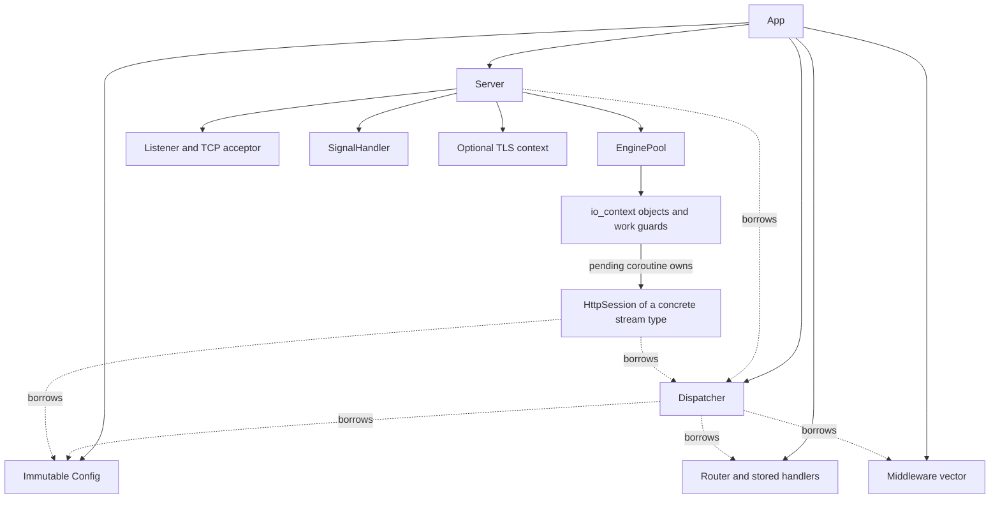
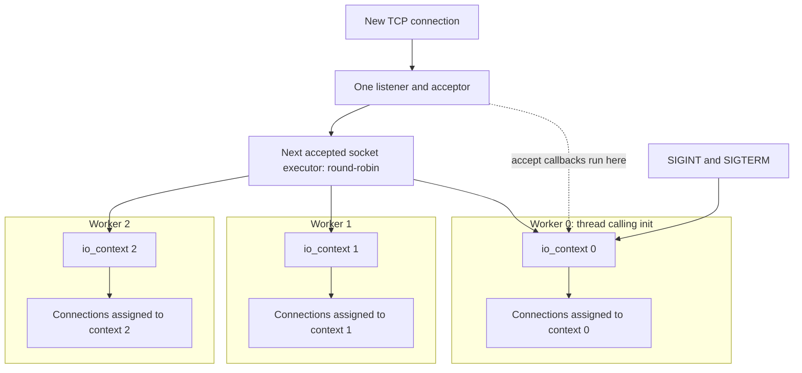
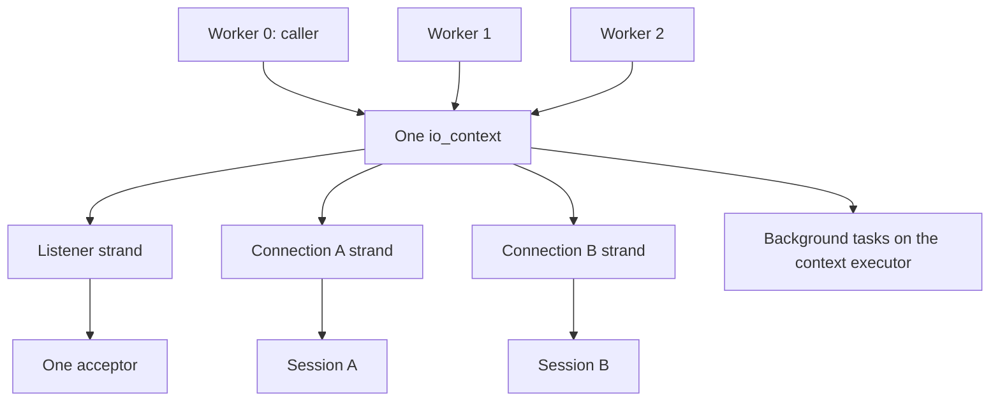
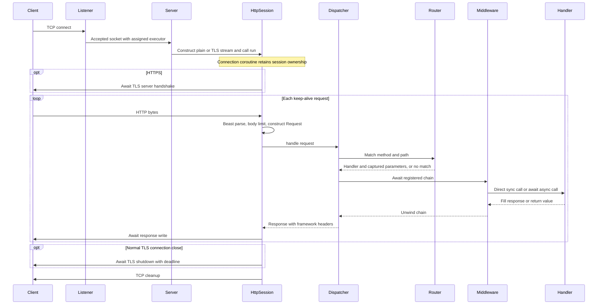

# Architecture

moji has one application and one listening server. `ExecutionModel` changes how the server runs its Asio event loops; it does not create an independent application/router for each worker.

## Ownership

`App` owns the router, middleware, config, dispatcher, and server. The dispatcher/server/session borrow stable references to those objects. Register routes and middleware before startup; those containers are not mutated while serving requests.

The listener accepts a socket and constructs a shared session. After `session->run()`, the local shared pointer can disappear: the connection coroutine holds a `shared_ptr` parameter across its suspensions. The listener does not store a collection of sessions.

The SSL context is configured before acceptance begins and reused by TLS streams. Its server member is declared before the engine so engine-owned pending sessions are released before the context is destroyed.

## Per-worker contexts

This is the default, `ExecutionModel::PerWorker`.

For `threads=N`, `EnginePool` owns N contexts, each constructed with the single-thread concurrency hint. The server starts N-1 `jthread` workers and runs worker 0 on the caller's thread. Exactly one thread runs each context; the hint alone is not what enforces that rule.

The acceptor runs on context 0. Each pending accept is given the executor for its next socket, selected round-robin. The accepted socket, TCP stream, optional TLS stream, and session inherit that connection executor.

A connection remains assigned to its context for its lifetime. Strands are unnecessary for these connection operations because only one thread runs the context. This is not OS core pinning or automatic load-based connection migration.

## One shared context

Select `ExecutionModel::SharedContext`.

All N threads run the same context. The acceptor has a strand, and each new socket receives a fresh connection strand.

A strand serializes the operations submitted through it, including the stream's composed I/O and timer work. It is not a thread reservation: successive handlers can execute on different workers. It is also not a lock held across a coroutine's suspension. The session's sequential request loop prevents overlapping HTTP work on that connection.

Different connections have different strands. They can concurrently call the same route or middleware. Those strands do not protect shared application data.

| Property | PerWorker | SharedContext |
|---|---|---|
| Context count | N | 1 |
| Threads running each context | 1 | N |
| Connection executor | Assigned context | Fresh strand on shared context |
| Acceptor executor | Context 0 | Strand on shared context |
| Connection migration | None | Handlers can move between worker threads |
| Shared application state | Must be synchronized | Must be synchronized |

Neither model makes blocking work free. A blocking handler occupies its worker. A shared context can schedule other runnable work on other workers, but cannot move an already executing blocking call elsewhere.

## Connection and request flow

`HttpSession<Stream>` shares the HTTP logic between `HttpStream` (`beast::tcp_stream`) and optional `TlsStream` (`beast::ssl_stream<HttpStream>`). Build guards remove SSL includes, context members, branches, and instantiations when TLS is disabled.

The handshake helper is awaited once per connection. For plain streams it returns immediately. For TLS streams it performs the handshake before any HTTP parsing. Normal TLS shutdown is also per connection, not per request.

A new Beast parser, moji request, and moji response are prepared for each request. The session's incoming flat buffer persists, including unread bytes belonging to a later pipelined request. Keep-alive reuses the connection/session, not one immutable request object.

## Handler adaptation and middleware

At registration, `App::wrap_handler()` examines the callable's return type using the function traits and `async_result` specialization. It stores either a `SyncHandler` or an `AsyncHandler` in a variant. The dispatcher checks that stored alternative when invoking the matched handler.

Synchronous handlers are called directly; asynchronous handlers are awaited. This distinction is independent of the execution model. All connections still use asynchronous network I/O, and middleware still has an asynchronous `Next` interface.

A `co_await` can suspend when an operation is pending, allowing the worker to run other ready work. It need not suspend if the result is already available. CPU work and blocking APIs remain ordinary work on the current thread.

The router currently performs a linear scan of pre-split registered routes. Middleware runs after lookup and can bypass the selected handler or fallback 404. Exceptions unwind to the dispatcher's error handler; post-`next()` middleware statements are not a finally block.

## Writing responses

The session converts moji's response into a Beast response. For string bodies up to 64 KiB, it collects Beast serializer buffers into the session-owned outgoing string and awaits an Asio write on `stream_`. Files and larger bodies use Beast's normal response-writing path.

This outgoing string is separate from the incoming flat buffer. Its contents are rebuilt for each response; it is not a response cache. Capacity over 128 KiB is released after a buffered write. TLS writes use the SSL stream, not a bypass to the underlying socket.

This design makes some deliberate copies. It is not universally zero-copy, and `file_body` is not by itself a promise of kernel `sendfile` behavior. The [historical investigation](performance-investigation.md) explains the measured reasons for the small-response path.

## Background work and lifetime

`App::spawn(Async<void>)` submits a detached coroutine. The contexts already exist during app construction, so tasks can be submitted before `init()`; they start when workers run.

In per-worker mode, a separate atomic round-robin counter selects the task context. In shared mode, tasks use the shared context's plain executor, not a connection strand. Background work is not automatically attached to whichever request called `spawn()`.

Work guards keep contexts alive even when a worker has no sockets yet. They do not create threads or make work execute before `run()`.

Pass owned values into background coroutines and handle failures inside tasks when they need reporting. Do not retain a request/response reference after the handler completes. Prefer named coroutine functions with value parameters over immediately invoking a temporary capturing coroutine lambda.

## Startup, errors, and stop

`App` progresses through Configuring, Running, Stopping, and Stopped. It publishes Running before listener setup finishes; this is a lifecycle state, not a readiness probe. Repeated startup or route registration after startup is rejected.

| Failure | Current handling |
|---|---|
| Invalid worker count | Exception during `App` construction |
| Bind or certificate load failure | Exception propagates from `init()` after cleanup |
| Malformed HTTP / invalid target | Session-level 400 where a response can be sent; connection ends |
| Oversized request body | Session-level 413; connection ends |
| Handler/middleware `HttpError` | Dispatcher JSON error with its status |
| Other standard handler/middleware exception | Dispatcher JSON 500 including exception message |
| Normal disconnect, cancellation, or timeout | Connection ends without another ordinary response |
| TLS handshake failure | Session boundary catches/logs and cleans up the transport |

SIGINT/SIGTERM run through one signal handler on context 0. `stop()` stops every context, workers are joined, and signal/listener cleanup follows. Responses are not drained; pending operation state is released during app destruction. `shutdown_timeout` bounds normal TLS connection shutdown, not an application-wide drain phase.

The app must outlive its blocking `init()` and concurrent public calls. Both models use the same ownership/lifecycle design; there is no public engine accessor for manually driving internal contexts.

## Implementation entry points

| Area | Source |
|---|---|
| Public registration and handler adaptation | [app.h](../include/moji/app.h) |
| Lifecycle and ownership | [app.cpp](../src/app.cpp) |
| Context ownership and executor selection | [engine_pool.cpp](../src/engine_pool.cpp) |
| Listener, worker startup, signals, TLS context | [server.cpp](../src/server.cpp), [listener.cpp](../src/listener.cpp) |
| Connection coroutine, parsing, writing, TLS handshake/shutdown | [http_session.cpp](../src/http_session.cpp) |
| Routing and middleware dispatch | [dispatcher.cpp](../src/dispatcher.cpp), [router.cpp](../src/router.cpp) |

For the underlying executor rules, see [Asio's strand documentation](https://www.boost.org/doc/libs/1_85_0/doc/html/boost_asio/overview/core/strands.html).
